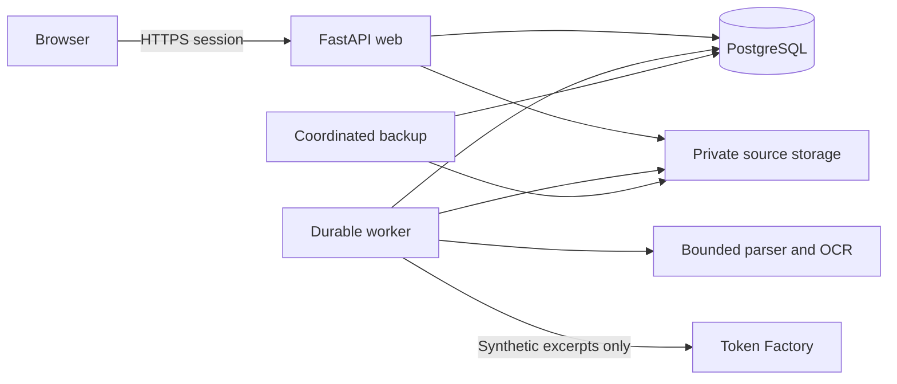
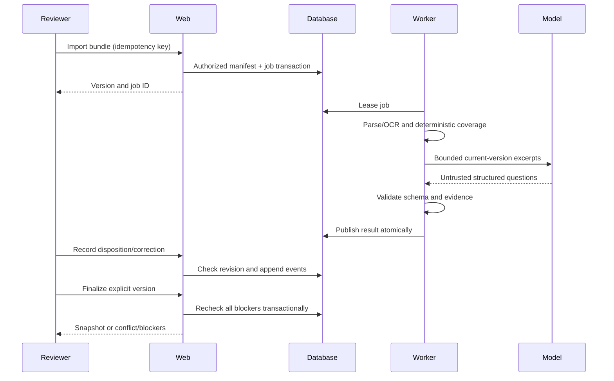

# System Design Document (SDD)

**Project:** Sentinel Claims
**Date:** 2026-10-21
**Version:** 0.1
**Owner:** Yushin
**Status:** Draft
**Last reconciled:** 2026-10-21
**PRD:** [Requirements](prd-sentinel-node.md)

Rapid design baseline for the approved slice. It describes target architecture, not the provisional scaffold's behavior. Exact dependency versions, migration columns and executable deployment contracts are finalized when implementation resumes.

## 1. Architectural Vision & Principles

Modular Python application with separate web and worker processes from one image. Keep original evidence immutable, enforce permissions at every resource boundary, and publish run results atomically. UI state is never the authority for completion.

PostgreSQL is standard locally and hosted. Optional SQLite supports lightweight development only. One CPU host is a failure domain; no high-availability claim. Avoid Kubernetes, a separate queue broker and microservices at this workload. Provider/model/storage adapters keep later moves reversible.

## 2. High-Level Architecture

| Layer | Choice | Responsibility |
|---|---|---|
| Client | HTML/CSS and small JavaScript client | Queue, workbench, source viewing, explicit job/check state |
| Web | Python/FastAPI, SQLAlchemy | Authentication, authorization, contracts, transactional review transitions |
| Worker | Separate process, PostgreSQL durable queue | Parse/OCR, checks, bounded inference, publish run |
| Data | PostgreSQL; private object storage | Versions, history, permissions and original documents |
| Hosting | Nebius CPU VM, HTTPS, persistent volumes | Containers, backups, monitored operation |

| Must-Have | Components | Resources |
|---|---|---|
| PRD-F1 | Auth service and queue | Accounts, memberships, sessions, cases |
| PRD-F2 | Import service, storage, extraction worker | Bundle versions, documents, extractions |
| PRD-F3 | Rule service and model adapter | Profiles, runs, check results, findings/evidence |
| PRD-F4 | Review service | Dispositions, tasks, append-only events |
| PRD-F5 | Completion/export service | Finalization snapshots, reports, event metrics |
| PRD-F6 | Web/worker, deployment and recovery | Jobs, object manifests, health and backup records |

## 3. Data Architecture

Rapid/Tiny relationship sketch; migration-ready columns are required before code changes. IDs are UUIDs, times UTC timestamptz, currency Decimal/numeric (never binary float), statuses constrained enums/text checks. Every case-scoped record has a facility boundary and source version; foreign keys must prevent cross-case associations.

| Entity | Required keys/data and invariants |
|---|---|
| Account / membership / session | Unique normalized account identifier; protected credential or identity-provider subject; explicit roles; disabled state; revocable session digest and expiry; privileged MFA enrollment |
| Case | facility_id, encounter_ref, claim_ref, assignee_id, state, current_bundle_id, revision integer; assignment checked for every related operation |
| Bundle version | case_id, sequence unique per case, manifest hash, profile_version, created_by/time; immutable membership after commit |
| Document | bundle_id, content hash, opaque private object key, declared type, detected MIME, byte/page count, encounter association, quarantine state |
| Extraction / confirmation | document_id, extractor version, page/field anchors, text/value, uncertainty; human confirmation stores actor/source separately, never rewrites original |
| Profile / rule version | Immutable content, source/effective date, supported scope and checklist; publication event; activation invalidates affected reviews |
| Audit run / job | bundle_id, rule_version, model/prompt/config digest; job status, lease expiry, attempts, idempotency key; one published result per run |
| Check result / finding | run_id, check_id, state, source anchors, evidence question; deterministic and model origin distinguishable |
| Disposition | finding/version, actor, reason, evidence, action, created_at; append-only supersession, no silent overwrite |
| Correction task / event | case/version, finding references, responsible person/department, status, handoff/ack times; every change appends actor/time/reason |
| Finalization / report | case/version/rule/run references, actor, completion snapshot, digest, export format/provenance; stale when relevant inputs change |
| Audit event | opaque entity IDs, actor/action/timestamp, sanitized metadata; append-only within retention policy; privileged deletion logged |

Case 1:N bundles; bundle 1:N documents and runs; run 1:N results/findings; finding 1:N dispositions/tasks. Finalization points to a complete immutable snapshot. Exports never follow a mutable ?latest? source pointer.

Use transactions plus compare-and-swap case revision for decisions/finalization; stale edits return conflict. Finalize checks current bundle/rules, findings, P01?P10 and tasks in the same transaction. Revisions conservatively reopen all dependent review if finer dependency is uncertain. Database uniqueness makes retry safe.

Worker claims leases atomically; expired leases can retry within a configured bound. Completion and result publication use one transaction. Retrying after crash cannot duplicate published findings. Uploads first enter quarantine; only a committed manifest is visible to review. Clean orphaned objects through a recorded retention job, never by guessing filesystem paths.

Index facility/assignee/state and created_at for queue; case/version and run IDs for history. No vector store or application cache initially. Backward-compatible additive migrations for one release; destructive changes require a verified backup and separate rollout.

## 4. API Design & External Integrations

REST with validated request/response schemas. Inline route intent below is the current contract; generated OpenAPI and exact payloads must be checked during implementation. All case routes authorize ownership/assignment before reading metadata or serving files.

| Method / path | Purpose and essential contract |
|---|---|
| POST /api/session; DELETE /api/session | Authenticate/MFA as needed; set/revoke secure session; never return password/session secret in response body |
| GET /api/claims | Authorized filtered/paginated queue, PRD-F1 |
| POST /api/claims | Create scoped case, identifiers/profile, PRD-F1 |
| POST /api/claims/:id/bundles | Multipart sources plus declared membership and idempotency key; return bundle/import-job IDs, PRD-F2 |
| GET /api/claims/:id/bundles/:version | Coverage and immutable manifest, PRD-F2 |
| GET /api/documents/:id/content | Authorize case, then private source stream; safe content type/download disposition, PRD-F2 |
| POST /api/extractions/:id/confirmations | Source anchor, corrected extracted value, reason and case revision, PRD-F2 |
| POST /api/claims/:id/runs | Explicit bundle/rule version plus idempotency key; return durable run/job ID, PRD-F3 |
| GET /api/runs/:id | Coverage/status/findings and exact evidence anchors, PRD-F3 |
| POST /api/findings/:id/dispositions | Decision/reason/evidence plus expected revision, PRD-F4 |
| POST /api/claims/:id/corrections | Responsible recipient/department, finding/anchor links, reason, PRD-F4 |
| POST /api/corrections/:id/events | Handoff/acknowledge/resolve/cancel with reason and expected revision, PRD-F4 |
| POST /api/claims/:id/finalizations | Explicit bundle/rule/run and expected revision; server enforces completion, PRD-F5 |
| GET /api/reports/:id; GET /api/overview | Authorized versioned report or supervisor event metrics, PRD-F5 |
| /api/admin/accounts; /api/admin/profiles | Admin-only changes, audit log; published immutable versions, PRD-F1/PRD-F3 |
| GET /health/live; GET /health/ready | Minimal health only; detailed diagnostics restricted to admin, PRD-F6 |

Errors have safe code/message and correlation ID. Use 401 for no valid session, 403/404 without leaking unauthorized objects, 409 for stale/idempotency conflicts, 413 for size excess, 422 for invalid supported contracts and 429 for rate limits. Unsupported content is a visible import/check state, not a successful validation.

### 4.1 Runtime sequences

External services: Token Factory (timeouts/429 bounded retry then explicit failure); private object storage (retry transient failures, never commit missing sources); future hospital export adapter (unknown until qualification). No payer submission endpoint. Official XML versions and encryption are not inferred from sample fixtures.

## 5. Security & Authorization

Named accounts, server-managed revocable sessions with HttpOnly/Secure/SameSite cookies, CSRF protection for state changes and rate-limited authentication. Reauthenticate sensitive administration; MFA for supervisor/admin. Exact authentication library and timeout defaults are implementation decisions requiring current official guidance before coding.

Deny by default and check permissions on each request, including source/range downloads, exports, jobs and child resources. Admin is not a clinical role. [OWASP authorization guidance](https://cheatsheetseries.owasp.org/cheatsheets/Authorization_Cheat_Sheet.html), checked 2026-10-21, supports this boundary.

Private buckets/files, encryption in transit/at rest/backups, no source or prompt content in logs, secrets injected outside Git. Minimize model excerpts and use synthetic patient data only. Audit document access, exports and privilege/profile changes.

Enforce PRD limits before expensive parsing; inspect content signatures, quarantine and scan uploads, reject path traversal and active content, isolate extraction with CPU/memory/time limits. Disable XML external entities/network resolution, sanitize printable output and CSV formula cells, escape model text. Unknown schema stays unsupported. Account restriction and sample-only notice cannot prove an upload lacks real patient data; supervised operators control import access and quarantine unexpected records.

## 6. Infrastructure, CI/CD & Deployment

One image, separate web/worker; PostgreSQL with persistent storage; local filesystem storage adapter for development, private object store hosted. Standard local Docker environment uses PostgreSQL. Development, evaluation and any future hospital deployment use separate credentials/database/storage.

CPU target around 4 vCPU/16 GB RAM is provisional, not a purchased/available preset. Remote inference means no dedicated GPU requirement. Account/region/quota/price and exact versions remain TBD before provisioning. [Nebius Compute](https://docs.nebius.com/compute) and [Storage](https://nebius.com/services/storage) are offering references, not deployment evidence.

CI required by multiple contributors: lint, tests, database integration and critical browser flows; failed checks block merge. Pin dependencies/image digests and scan them when packaging. No build pipeline or deploy command is claimed complete.

Daily encrypted coordinated database/object backups; seven recovery points. Evaluation RPO 24 hours, RTO one business day. Restore to clean isolation and verify document hashes, access and histories before release. Restore tested: **not yet**. PRD ?9 is the rollback source.

## 7. Non-Functional Requirements

| Requirement | Target | Evidence status |
|---|---|---|
| Queue/case interactions p95 | Under 2 seconds | Unmeasured |
| Text audit processing p95 | Under 2 minutes, queue wait separate | Unmeasured |
| Supported scan audit p95 | Under 5 minutes, queue wait separate | Unmeasured |
| Load | Five active reviewers, two concurrent audits; 100 imports/day; 10,000 retained metadata records | Planning assumption |
| Availability | Supervised sessions; no contractual uptime promise; alert after two consecutive failed minute probes | Monitoring unimplemented |
| Retention | Evaluation records 90 days; seven daily backup points; expiry records | Policy target, not implemented |
| Recovery | RPO 24h; RTO one business day | No restore drill |
| Integrity | Zero wrong-version evidence or false finalizations in QAD | Untested |

Hospital retention/recovery requirements must be agreed before real-record use.

## 8. AI / Agent Architecture

One bounded comparison task, no autonomous tools. Selected family Nemotron 3 Super via Token Factory; exact model ID/version, endpoint and structured-output compatibility TBD before live evaluation. OCR engine/version also TBD; source-backed confirmation is required regardless of confidence.

System instructions define comparison and output schema. User-controlled documents enter a separate untrusted-data envelope with case/version/page/field IDs. Exclude unrelated cases, account identifiers and secrets. Validate output JSON, allowed check IDs, bounded lengths and evidence locations/quotes against actual inputs. Unsupported evidence is discarded and reflected as failed coverage, not silently trusted.

Provisional engineering caps: 12,000 input tokens and 2,000 output tokens per call, at most four comparison calls per run, at most two transient retries per call, 60-second request timeout. Coverage budgeting must account for retries. If a bundle exceeds covered context, mark unreviewed checks Not run or require manual review; never truncate and imply completion. Verify caps against the selected endpoint and timing targets before enabling. Actual monetary ceiling is configured from owner-approved budget before live calls; stop new inference when exhausted.

### 8.1 AI Safety & Threat Surface

| Risk | Control | QAD eval |
|---|---|---|
| LLM01 direct/indirect prompt injection | Documents are data; no tools; output schema/evidence allowlist | AI-04 |
| LLM05 improper output handling | Escape text, reject unknown keys and executable/link payloads | AI-08 |
| LLM02 sensitive disclosure | One-case context, no secrets, no raw traces, separate environment | AI-06 |
| LLM06 excessive agency | No submission, mutation, search, payment or admin tools | AI-05 |
| Jailbreak | Same bounded output and no authority; no unlimited retries | AI-07 |
| Confabulation | Exact source validation, reviewer decision and explicit abstention | AI-01/AI-03 |
| Resource exhaustion | File/context/call caps, queue limits and operator kill switch | AI-09 |

Provider receives only permitted synthetic excerpts initially. Retention/training terms and processing region are **unverified for the actual account**; do not send real records. Reconcile those terms with CLR before expanding data scope.

### 8.2 AI craft

| Craft | Decision |
|---|---|
| Prompt | Versioned system/task instructions separated from document data |
| Context | Only current-case anchored excerpts; included/excluded coverage recorded |
| Harness / tools | Structured data output only; server validates every evidence reference |
| Loop | Finite comparison calls/retries; stop on cap, permanent error or operator pause |
| Token / cost | Record token counts, latency, provider request ID and configured budget state without raw content |
| Eval | QAD AI-01 through AI-09 before any model/prompt/rule change; AIA owns residual risk |

## Self-Check

- [x] Every Must-Have maps to components; security, failures and data relationships specified.
- [ ] Exact versions, full migrations/contracts, live provider limits, deploy and restore proof completed.
